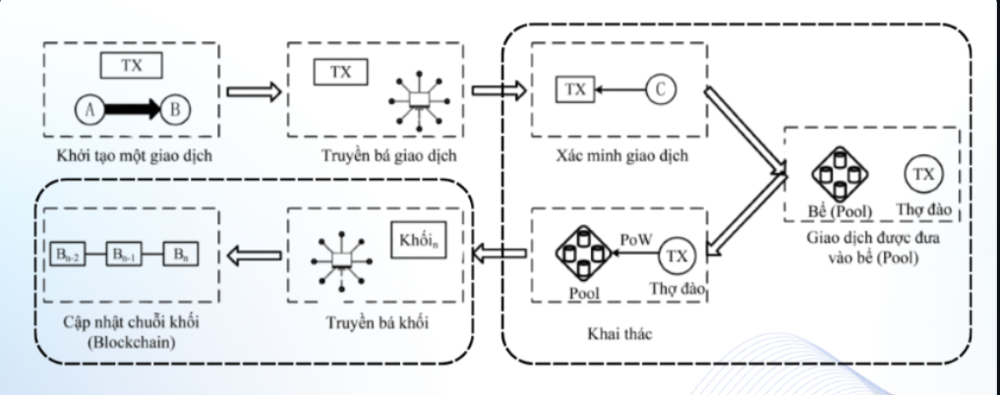

# Session 02 - <HOW Blockchain Works>

- Student: Nguyễn Minh Hiếu
- GitHub: https://github.com/MynameisHiu
- Submitted: 25/10/2026
- Commit: [<URL>](https://github.com/MynameisHiu/Dev-Log-bootcamp/blob/main/submissions/MynameisHiu/session-02.md)

## 1. Summary
- Tổng quát về cách dữ liệu được đóng gói, mã hóa và lưu trữ, bao gồm cấu trúc chi tiết của Block và BlockChain
- khái niệm Transaction (Giao dịch), mô hình Ledger/State (sổ cái và trạng thái)
- Vai trò của Node trong Mạng ngang hàng (P2P Netword)
- Quy trình chi tiết về dòng đời của 1 giao dịch (Transaction Lifecycle)
- Công cụ tra cứu Blockchain Explorer
## 2. Topic notes
1. Block and Block Structure
- Các khối nối tiếp nhau thành chuỗi thông qua việc khối sau lưu trữ `Previous block hash` của khối trước. Khối đầu tiên được tạo ra trong toàn bộ mạng lưới gọi là Genesis Block (Khối khởi nguồn) có giá trị `Previous Hash` mặc định là `0000`
2. Giao dịch (Transaction)
- Định nghĩa: Giao dịch (Transaction) được định nghĩa là đơn vị công việc nhỏ nhất làm thay đổi trạng thái của mạng lưới.
- *Ý nghĩa: Mỗi khi có sự chuyển giao tài sản (token/coin) hoặc tương tác với Smart Contract, một giao dịch mới được khởi tạo và phát tán để ghi nhận sự thay đổi trên sổ cái chung.
3. Sổ cái và Trạng thái (Ledger / State)
- Ledger (Sổ cái): Lưu trữ lịch sử toàn bộ các giao dịch đã xảy ra từ khối Genesis cho đến khối mới nhất.
- State (Trạng thái) Biểu diễn số dư tài khoản, dữ liệu Smart Contract hoặc trạng thái hiện tại của toàn bộ hệ thống sau khi thực thi danh sách các giao dịch.
4. Các Nodes và Mạng ngang hàng (P2P Network)

- Mạng ngang hàng (P2P Network): Mạng lưới phi tập trung nơi các máy tính tự kết nối trực tiếp với nhau mà không cần thông qua server trung gian.
- Nodes (Các nút): Các máy tính tham gia mạng lưới có nhiệm vụ duy trì, xác thực giao dịch, lưu trữ bản sao sổ cái và lan truyền dữ liệu.
- Full node
+ Tải • xác minh • lưu lịch sử
+ Thực thi luật đồng thuận
- Light node
+ Chỉ tải block header
+ Nhanh, nhẹ — phù hợp ví di động
5. Vòng đời của một Giao dịch (Transaction Lifecycle)

Quy trình hoạt động của một giao dịch từ khi khởi tạo đến khi hoàn tất diễn ra qua các bước chính:

1. Tạo giao dịch: Người dùng khởi tạo lệnh chuyển tiền/tương tác trên ứng dụng ví.
2. Ký số (Digital Signature): Dùng khóa riêng tư (Private Key) để ký xác nhận quyền sở hữu và tính hợp lệ của giao dịch.
3. Phát tán (Broadcast): Giao dịch được gửi lên mạng ngang hàng (P2P).
4. Mempool (Hàng chờ xác thực): Các node tiếp nhận, kiểm tra tính hợp lệ và đưa giao dịch vào bể chứa tạm thời (Mempool).
5. Đóng khối (Block Assembly và Consensus): Các node xác thực (Validators/Miners) gom các giao dịch từ Mempool, tạo khối mới và thực thi thuật toán đồng thuận.
6. Xác nhận và Cập nhật trạng thái: Khối mới được liên kết vào Blockchain, toàn bộ các node cập nhật lại trạng thái sổ cái mới.

6. Trình khám phá Blockchain (Blockchain Explorer)

- Chức năng: Công cụ giao diện web công khai cho phép người dùng tìm kiếm, kiểm tra trạng thái giao dịch, địa chỉ ví, thông tin khối, phí giao dịch và các chỉ số hoạt động của toàn mạng lưới.

## 3. Work completed

Không có

## 4. Evidence

Ko có
## 5. Blockers

không có

## 6. Takeaway
không có
