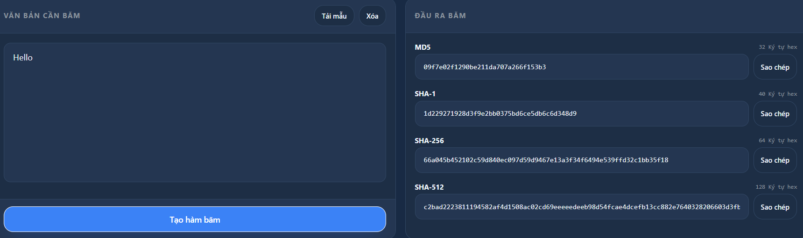
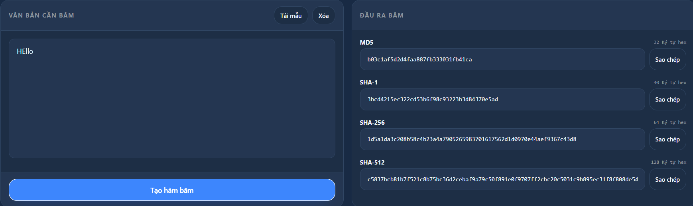
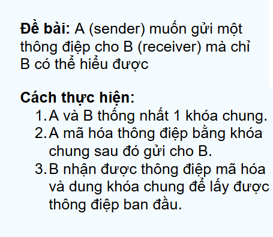
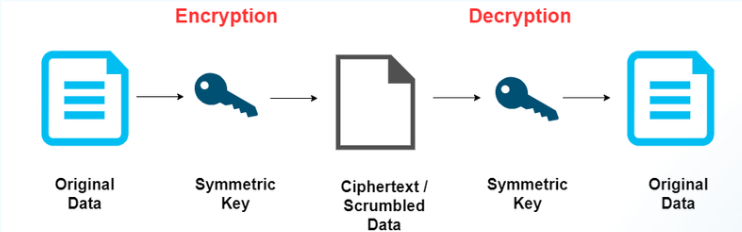
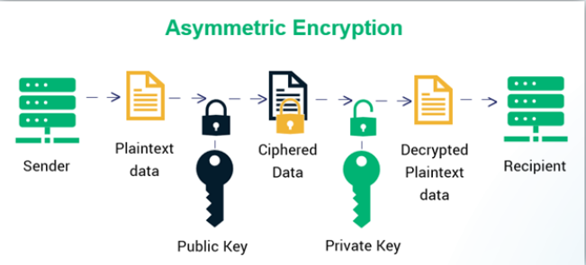
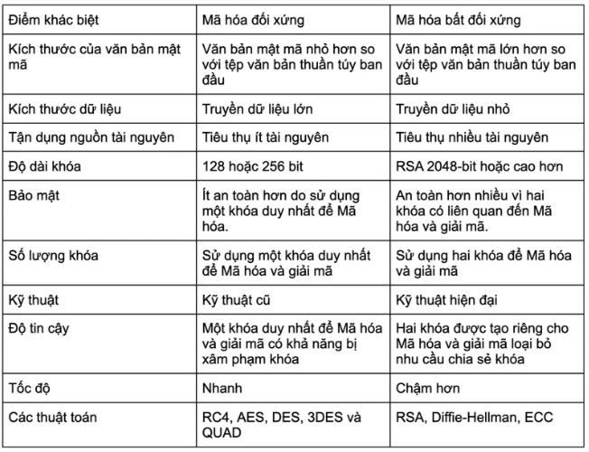
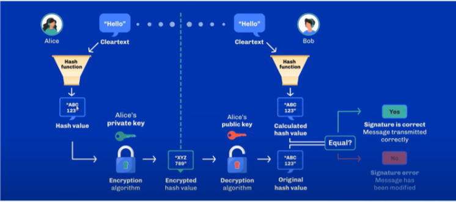
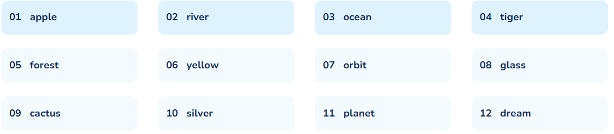
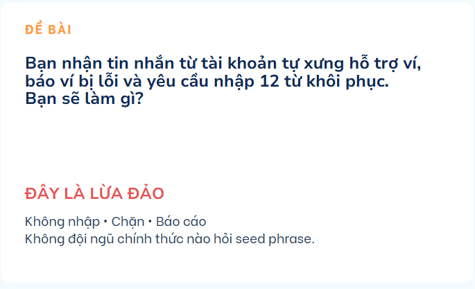
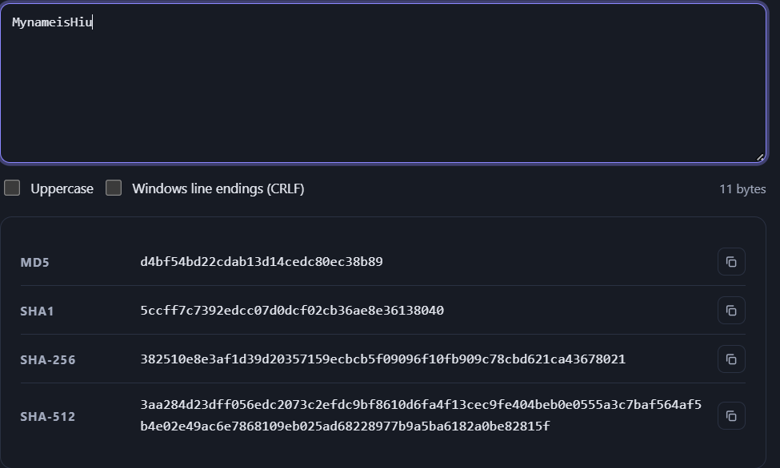

# Session 03 - Cryptography & Wallet

- Student: Nguyễn Minh Hiếu
- GitHub: [MynameisHiu](https://github.com/MynameisHiu)
- Submitted: 1/11/2026
- Commit: <https://github.com/MynameisHiu/Dev-Log-bootcamp/tree/main/submissions/MynameisHiu>

## 1. Summary

- Làm rõ các khái niệm cốt lõi bao gồm hàm băm (Hashing), cặp khóa bất đối xứng (Public và Private Key), chữ ký số (Digital Signature), quy trình sinh địa chỉ ví (Address), cụm từ khôi phục (Seed Phrase), phân loại ví (Hot/Cold Wallet, Custodial/Non-custodial) và các nguyên tắc bảo mật ví quan trọng.

## 2. Topic notes

### 1. Hashing (Hàm băm)

- Biến dữ liệu có độ dài bất kỳ thành chuỗi đầu ra có độ dài cố định.
- Khi thay đổi 1 ký tự trong dữ liệu đầu vào, giá trị băm cũng thay đổi hoàn toàn.
- Ví dụ:

 và 

#### Hàm băm được sử dụng ở đâu

1. Định danh giao dịch: tạo mã hóa duy nhất cho mỗi transaction.
2. Liên kết block: mỗi block tham chiếu hash của block trước đó.
3. Merkle tree: tóm tắt và xác minh hàng ngàn giao dịch.
   - Được xây dựng từ dưới lên, kết quả là một hàm băm duy nhất.
   - Ví dụ: 4 giao dịch -> 4 mã hash -> 2 mã hash -> 1 mã hash duy nhất.
4. Proof of Work: tìm hash thỏa điều kiện của mạng.

#### Tính chất của hàm băm

1. Tính một chiều
   - Hầu như không thể suy ngược lại giá trị ban đầu.
2. Tính xác định
   - Cùng một giá trị đầu vào luôn cho ra cùng một đầu ra tại một thời điểm.
3. Tính toán nhanh
   - Quá trình tính toán dữ liệu đầu vào diễn ra nhanh chóng, không tốn nhiều tài nguyên xử lý.
4. Hiệu ứng tuyết lở
   - Chỉ cần thay đổi một dữ liệu đầu vào rất nhỏ, giá trị băm cũng sẽ thay đổi hoàn toàn khác biệt.
5. Kháng xung đột
   - Khó có thể tìm ra cặp đầu vào nào đưa ra hàm băm giống nhau.

### Mã hóa

- Mã hóa một chiều: quá trình biến đổi dữ liệu thành một định dạng không thể thay thế được.
- Mã hóa hai chiều: quá trình biến đổi dữ liệu cho phép mã hóa và sau đó giải mã để lấy dữ liệu gốc. Được chia thành hai loại:

#### 1) Mã hóa đối xứng

- Sử dụng cùng một loại khóa cho cả quá trình mã hóa và giải mã.
- Ví dụ:

- Sơ đồ:

- Lưu ý: Nếu khóa bí mật bị lộ, dữ liệu mã hóa có thể bị giải mã bởi bất kỳ ai có khóa.

#### 2) Mã hóa bất đối xứng

- Sử dụng một cặp khóa (Public Key và Private Key) cho quá trình mã hóa và giải mã.
- Sơ đồ:

#### Bảng so sánh mã hóa đối xứng và mã hóa bất đối xứng

### 2. Public key và private key

- Private key (Khóa riêng tư): là một số ngẫu nhiên 256-bit cực kỳ quan trọng, quyết định quyền sở hữu tài sản và phải được giữ bí mật tuyệt đối.
- Public key (Khóa công khai): được sinh ra từ private key bằng thuật toán đường cong elliptic (secp256k1).
- Quy tắc một chiều: dễ đi xuôi nhưng gần như không thể đi ngược.
- Minh họa:
  1. Private key -> Public key: possible
  2. Public key -> Private key: impossible

### 3. Chữ ký số (Digital Signature)

- Đề bài:

- Quy trình ký và xác minh:

- ECDSA tạo bằng chứng hợp lệ mà không bao giờ truyền private key lên mạng.
- Đề bài: A muốn gửi một tài liệu cực kỳ quan trọng cho B. Làm sao để B biết tài liệu đó có đúng là được gửi từ A hay không?
- Sơ đồ thực hiện chữ ký số:

- Lợi ích: đảm bảo tính xác thực (đúng người gửi) và tính toàn vẹn (dữ liệu giao dịch không bị sửa đổi trong quá trình truyền tải).

### 4. Chuỗi tạo địa chỉ ví (Từ private key đến Address)

- Quy trình biến đổi một chiều tạo nên danh tính nhận tài sản trên Blockchain:

$$
\text{Private Key (256-bit)} \xrightarrow{\text{secp256k1}} \text{Public Key} \xrightarrow{\text{Hashing}} \text{Hash rút gọn} \longrightarrow \text{Address (Địa chỉ ví)}
$$

- Lưu ý: bạn chia sẻ address chứ không chia sẻ private key.

### 5. Wallet

- Ví thực sự là gì?
  - Ví không hề chứa coin/token.
  - Tài sản luôn nằm trên Blockchain; ví chỉ là công cụ quản lý cặp khóa (Private/Public Key) và thực hiện ký các giao dịch.

#### Hot wallet

- Kết nối internet
- Tiện dụng, giao dịch nhanh
- Rủi ro tấn công cao hơn

#### Cold wallet

- Khóa được giữ ngoại tuyến
- Phù hợp lưu trữ dài hạn
- An toàn hơn nếu dùng đúng

#### Seed Phrase - Cụm từ khôi phục

- Sử dụng BIP-39 với 12 hoặc 24 từ tiếng Anh để sinh toàn bộ khóa của ví HD (BIP-32/44).
- Minh họa (không dùng cho ví thật):

### Custodial vs Non-custodial Wallet

#### Custodial

- Bên thứ ba giữ private key
- Khôi phục tài khoản thuận tiện
- Phụ thuộc nền tảng và chính sách

#### Non-custodial

- Bạn tự giữ private key
- Toàn quyền kiểm soát tài sản
- Tự chịu trách nhiệm bảo mật

#### Checklist bảo vệ ví cơ bản

#### Đề bài tình huống và cách giải quyết

## 3. Work completed

- Sử dụng web để hiểu về cách mã hash hoạt động.

## 4. Evidence

- Không

## 5. Blockers

- Không

## 6. Takeaway

- Không