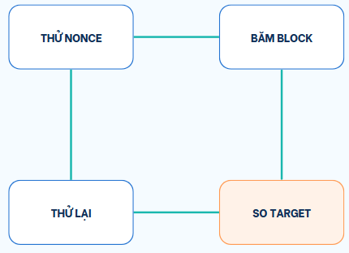
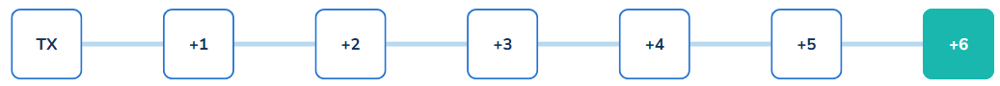
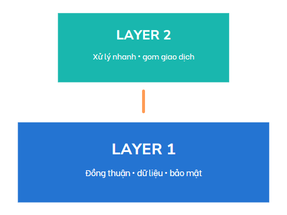
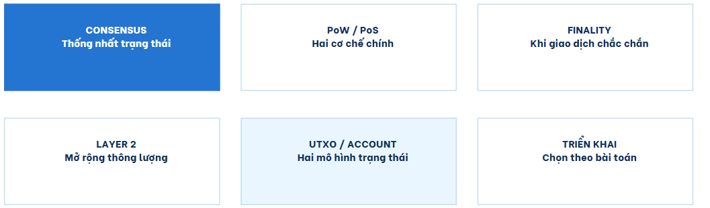

# Session 04 - <CONSENSUS & BLOCKCHAIN ARCHITECTURE (Đồng thuận và kiến trúc Blockchain)>

- Student: <Nguyễn Minh Hiếu>
- GitHub: [@MynameisHiu](https://github.com/MynameisHiu)
- Submitted: 2026/11/11
- Commit: <https://github.com/MynameisHiu/Dev-Log-bootcamp/blob/main/submissions/MynameisHiu/session-04.md>

## 1. Summary
Giải quết bài toán thống nhất trạng thái trên mạng lưới phân tán và cách tổ chức các tầng mở rộng trong kiến trúc hệ thống Blockchain.
Bài học hệ thống hóa cơ chế đồng thuận (Consensus) xuất phát từ bài toán Byzantine, phân tích chuyên sâu hai thuật toán cốt lõi là **Proof of Work (PoW)** và **Proof of Stake (PoS)**
Định nghĩa khái niệm **Tính chung cuộc (Finality)**, giải mã **Tam giác bất khả thi (Blockchain Trilemma)**, so sánh các mô hình biểu diễn trạng thái (**Account-based vs UTXO**) 
Phân loại các mô hình triển khai (**Public, Private, Permissioned**), và ứng dụng kiến trúc vào bài toán thực tế như hệ thống cấp bằng đại học.

## 2. Topic notes

### 2.1\. Cơ chế Đồng thuận (Consensus) &amp; Bài toán Byzantine

* **Đặt vấn đề**: Làm thế nào để hàng nghìn máy tính không quen biết, không tin tưởng lẫn nhau và không có máy chủ trung tâm có thể cùng đồng ý về khối tiếp theo được ghi vào sổ cái? ĐỀ BÀI
  Ví dụ: 1.000 máy tính không tin nhau, không có máy chủ trung tâm. Ai được ghi block tiếp theo — và làm sao tất cả cùng đồng ý?
* **Bản chất của Consensus**: Consensus là cơ chế để các node thống nhất một trạng thái chung, kể cả khi có node lỗi hoặc gian lận — nối lại bài toán Byzantine ở Buổi 01..

### 2.2\. So sánh các Thuật toán Đồng thuận (PoW vs PoS) &amp; Tính chung cuộc (Finality)

* **Proof of Work (PoW)**:
  * **Cơ chế**: Thợ đào (Miner) thực hiện cuộc đua tính toán tìm giá trị `nonce` sao cho mã băm của khối nhỏ hơn mục tiêu độ khó (`hash &lt; target`). Thợ đào tìm ra đầu tiên sẽ được quyền thêm khối mới và nhận phần thưởng khối.

  

  * **Đặc điểm**: Đảm bảo an ninh bằng chi phí tính toán thực tế, nhưng tiêu tốn lượng điện năng và tài nguyên máy đào rất cao.
* **Proof of Stake (PoS)**:
  * **Cơ chế**: Người xác thực (Validator) bắt buộc phải khóa (stake) một lượng coin nhất định làm tài sản đảm bảo. Hệ thống chọn validator để đề xuất khối mới và các validator khác sẽ xác thực.
  * **Cơ chế Slashing**: Nếu validator cố tình gian lận hoặc vi phạm quy tắc, tài sản ký quỹ sẽ bị phạt/tước đoạt (slashing). PoS dùng động lực kinh tế để thay thế cho cuộc đua tiêu thụ điện năng.
  * **Bảng so sánh PoW và PoS**:

| Tiêu chí                  | Proof of Work (PoW)        | Proof of Stake (PoS)           |
| ------------------------- | ------------------------------- | -------------------------------- |
| **Tài nguyên yêu cầu**    | Điện năng &amp; Máy đào chuyên dụng | Coin ký quỹ (Stake)              |
| **Người tạo khối**        | Miner (Thợ đào)                 | Validator (Người xác thực)       |
| **Cơ chế an ninh**        | Chi phí tính toán phần cứng     | Phạt tiền ký quỹ (Slashing)      |
| **Năng lượng tiêu thụ**   | Rất cao                         | Thấp hơn đáng kể                 |
| **Finality (Chung cuộc)** | Theo xác suất (Probabilistic)   | Thường nhanh hơn (Deterministic) |

**Tính chung cuộc (Finality)**:
* **Định nghĩa**: Finality là thời điểm một giao dịch được xác nhận chính thức và không thể bị đảo ngược hay thay đổi.
* **Cơ chế xác thực**: Trong mạng PoW (như Bitcoin), mỗi khi có thêm một khối mới được nối tiếp vào chuỗi (Tx +1, +2, +3...), xác suất giao dịch bị đảo ngược sẽ giảm dần cho đến khi đạt mức an toàn tuyệt đối (chung cuộc).



### 2.3\. Tam giác bất khả thi (Blockchain Trilemma) &amp; Kiến trúc Layer 1 / Layer 2

* **Blockchain Trilemma**: Đề cập đến bài toán đánh đổi kiến trúc khi một hệ thống Blockchain rất khó đạt được đồng thời cả 3 mục tiêu:
  1. **Phi tập trung (Decentralization)**.
  2. **Bảo mật (Security)**.
  3. **Khả năng mở rộng (Scalability)**.
* Đây là lí do Layer 2 ra đời
* **Giải pháp mở rộng xếp tầng (Layer 1 &amp; Layer 2)**:
  * **Layer 1 (Cao tốc chính)**: Đảm nhận nhiệm vụ cốt lõi về cơ chế đồng thuận, lưu trữ dữ liệu và bảo mật an ninh cho toàn bộ hệ thống.
  * **Layer 2 (Đường gom/Đường nhánh)**: Đảm nhận việc xử lý nhanh các giao dịch off-chain, gom nhiều giao dịch lại rồi nhập kết quả xác nhận cuối cùng về Layer 1, giúp giải tỏa nghẽn mạng cho chuỗi chính.

  

### 2.4\. Hai mô hình biểu diễn trạng thái (Account-based vs UTXO)

* **Mô hình Account-based**:
  * Vận hành tương tự như số dư tài khoản ngân hàng truyền thống.
  * Trạng thái tài khoản được cập nhật trực tiếp sau mỗi giao dịch (ví dụ: An có 100 coin chuyển 30 coin cho Bình, số dư cập nhật trực tiếp thành An: 70, Bình: 50).
* **Mô hình UTXO (Unspent Transaction Output)**:
  * Vận hành giống như các tờ tiền giấy chưa tiêu.
  * Giao dịch sử dụng các đầu vào (Inputs là các UTXO cũ), tiêu hết toàn bộ và tạo ra các đầu ra mới (Outputs là các UTXO mới, ví dụ: gộp hai tờ 50 để tạo ra tờ 70 trả cho người nhận và 30 tiền thừa trả lại).

### 2.5\. Phân loại các Mô hình triển khai Blockchain

Bảng đối chiếu 3 hình thức triển khai dựa trên quyền đọc, quyền ghi và mô hình niềm tin:

| Mô hình                  | Quyền Đọc           | Quyền Ghi                      | Cơ chế Niềm tin         |
| ----------------------------- | ------------------------- | ----------------------------------- | ---------------------------- |
| **Public Blockchain**         | Công khai cho tất cả      | Không cần cấp phép (Permissionless) | Dựa trên kinh tế mạng lưới   |
| **Private Blockchain**        | Giới hạn nội bộ           | Nội bộ một tổ chức kiểm soát        | Dựa trên uy tín tổ chức      |
| **Permissioned / Consortium** | Tùy chỉnh theo chính sách | Được cấp quyền (Permissioned)       | Dựa trên liên minh nhiều bên |

### 2.6\. Bài toán thực tế: Ứng dụng Blockchain trong Cấp bằng Đại học

* **Đề bài**: Các trường đại học muốn xây dựng hệ thống cấp và thu hồi bằng tốt nghiệp trên Blockchain.
* **Phương án kiến trúc tối ưu**:
  1. **Mô hình Liên minh (Consortium Chain)**: Thành lập mạng lưới Permissioned chain giữa các trường đại học để cùng quản trị và xác nhận bằng cấp.
  2. **Neo Merkle root lên Public Chain**: Nhằm đảm bảo tính minh bạch rộng rãi, các trường có thể gom các bằng cấp thành cây Merkle và chỉ đưa **Merkle root (bằng chứng mã hóa)** lên chuỗi Public.
  3. **Bảo vệ quyền riêng tư**: Dữ liệu cá nhân của sinh viên **không đưa trực tiếp lên blockchain**, public chain chỉ đóng vai trò lưu giữ bằng chứng chống giả mạo để bất kỳ ai cũng có thể kiểm tra.

### Tổng kết

* 


## 3. Work completed

1. **Phân tích kỹ thuật các cơ chế đồng thuận**:
  * So sánh chi tiết về nguyên lý, tài nguyên và độ an toàn giữa cuộc đua giải toán mã hóa (PoW) và khóa tài khoản đặt cược (PoS)[2][3].
  * Đánh giá khái niệm Finality và thời gian hoàn tất giao dịch trên chuỗi[3].
2. **Mô hình hóa kiến trúc mở rộng &amp; trạng thái**:
  * Phân tích sự đánh đổi trong bài toán Blockchain Trilemma và nguyên lý phân tầng Layer 1 / Layer 2[3][4].
  * Bảng phân biệt cơ chế quản lý trạng thái tài khoản giữa mô hình ngân hàng (Account-based) và mô hình tờ tiền (UTXO)[4].
3. **Sơ đồ 6 mảnh ghép kiến trúc Blockchain**:

```
====================================================================
BUỔI 04: CONSENSUS &amp; BLOCKCHAIN ARCHITECTURE - 6 CORE PILLARS
--------------------------------------------------------------------
1. CONSENSUS     -&gt; Bài toán Byzantine &amp; Thống nhất trạng thái chung
2. PoW / PoS     -&gt; Hai thuật toán đồng thuận &amp; Mô hình khuyến khích
3. FINALITY      -&gt; Xác nhận tính chắc chắn không thể đảo ngược
4. LAYER 1 / 2   -&gt; Giải pháp mở rộng xếp tầng giải quyết Trilemma
5. UTXO / ACCOUNT-&gt; Hai cách biểu diễn và cập nhật trạng thái sổ cái
6. DEPLOYMENT    -&gt; Chọn mô hình triển khai (Public/Private/Consortium)
====================================================================
```


## 4. Evidence
* Không có
## 5. Blockers

* Cần làm rõ thêm cách tính ngưỡng chịu lỗi $3f + 1$ trong các thuật toán PBFT/BFT khi áp dụng thực tế với số lượng node nhỏ.


## 6. Takeaway

* Kiến trúc xếp tầng (Layer 1 + Layer 2) là chìa khóa tháo gỡ điểm nghẽn mở rộng mà không làm suy yếu an ninh cốt lõi của blockchain.
